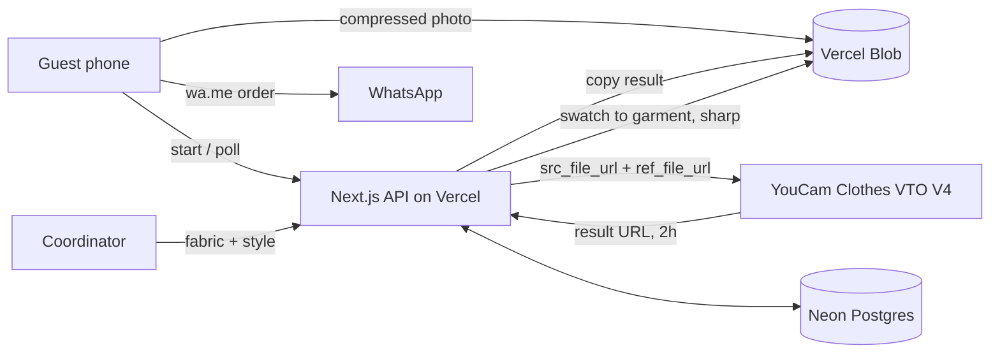

# AsoLink

**One link for your aso ebi.** A coordinator uploads the fabric for a Nigerian wedding or party. Guests open one link from the family WhatsApp group, see that fabric sewn into an outfit on their own photo, pick a size, and send a ready-written order on WhatsApp. The coordinator gets a live tracker of who ordered and which sizes to sew.

Live: **https://aso-link.vercel.app**

Built for the YouCam API Skin AI & eCommerce VTO Hackathon (Perfect Corp).

## The problem

Aso ebi is the matching fabric guests buy so a celebration's family and friends dress alike. Today it's coordinated by hand in WhatsApp groups:
- guests ask the same questions over and over,
- they buy fabric without knowing how it will look on them,
- the coordinator tallies sizes and payments from scattered chat messages.

AsoLink keeps WhatsApp, the channel everyone already uses, and removes the guesswork and the spreadsheet.

## How it uses the YouCam API

AsoLink is built on **AI Clothes Virtual Try-On (V4)**, `POST /s2s/v2.0/task/cloth-v4`:

- **Guest photo → `src_file_url`.** The phone compresses the photo (EXIF-corrected, 1280px, ~150–250 KB) and uploads it straight to Vercel Blob. YouCam fetches it by URL, so there's no second upload over weak mobile data.
- **The aso ebi → `ref_file_url`**, with `garment_category: "auto"`. This is either a photo of the sewn outfit, or a garment AsoLink synthesizes from the coordinator's fabric (see below).
- **Async jobs.** The server creates the task and stores the `task_id`. The phone polls our API, and the server polls YouCam at most once every 3 seconds per task. Results are copied to Blob straight away, because YouCam's result URLs expire after 2 hours.
- **Safeguards:**
  - Previews are cached per photo and style, so retries never cost extra units.
  - Caps: 3 previews per guest, a per-event cap, and a daily cap.
  - Every YouCam error code maps to a plain-language fix ("Stand straight, facing the camera…").
  - Jobs resume after a dropped connection or a page reload.

### Why not Fabric VTO directly?

The AI Fabric Virtual Try-On API only accepts Perfect Corp's preset fabric templates (leather, denim, sequins and so on). It can't take a fabric photo uploaded by a user, and none of its presets are ankara, lace or aso oke.

AsoLink bridges that gap with a **swatch-to-garment pipeline** (`src/lib/swatch.ts`):

1. A small library of white garments worn by real people (kaftan, fitted gown, long gown). Each has a hand-checked garment mask (`silhouettes/*.mask.png`).
2. The coordinator's fabric is tiled seamlessly across the garment. Hands and skin are excluded, and the white garment's own folds and shadows are kept as a shading layer, so the fabric drapes.
3. The result is a realistic photo of *that fabric sewn into that style*. It goes to Clothes VTO as the reference garment.

The coordinator sees and approves the synthesized outfit before publishing.

## What was tested

Before building, a spike (`spike/`) ran 57 real calls across Clothes VTO and Fabric VTO:
- 6 people with darker skin tones, including chest-up selfies,
- 4 traditional outfits,
- 3 fabrics: ankara, kente/aso oke, lace.

Results:
- 57/57 succeeded.
- Median task time was about 18s.
- Each call cost exactly 2 units, and failed calls weren't charged.
- Faces, skin tone, gele and coral beads were preserved.

`npm run smoke` drives the whole product end to end in 15 checks, against local or production: upload, synthesis, event, try-on, cache, WhatsApp order, tracker, CSV and access control.

## Architecture



- **Stack:** Next.js 16 (App Router), React 19, TypeScript, Tailwind 4, Neon Postgres, Vercel Blob, `sharp`.
- **Pages:**
  - `/`: landing page
  - `/new`: create an event
  - `/e/[slug]`: guest page, with a WhatsApp link-preview image
  - `/d/[token]`: private order tracker
  - `/p/[id]`: a shared preview
- **No sign-up:**
  - Coordinators get a secret tracker link; only its hash is stored.
  - Guests are identified by an httpOnly cookie.

## Run it locally

```bash
npm install
cp .env.local.example .env.local   # then fill in the values below
npm run db:migrate
npm run dev
```

Environment variables:
- `YOUCAM_API_KEY`: from the YouCam API console.
- `DATABASE_URL`: Postgres.
- `BLOB_READ_WRITE_TOKEN`: Vercel Blob.
- `YOUCAM_MODE=mock`: optional. Returns instant fake previews so UI work spends no units.

Scripts:

| Command | What it does |
| --- | --- |
| `npm run smoke [baseUrl]` | End-to-end product test |
| `npm run spike` | The API research spike (dry run unless `--yes`) |
| `npx tsx scripts/make-mask.ts …` | Builds a garment mask for a new style photo |

## Credits

- Style photos, demo photos and test photos: [Unsplash](https://unsplash.com/license). The demo results were generated from them with YouCam.
- Virtual try-on: [YouCam API](https://yce.perfectcorp.com/ai-api) by Perfect Corp.

Every preview is labelled as a visual preview, not a fit guarantee.

## License

MIT
